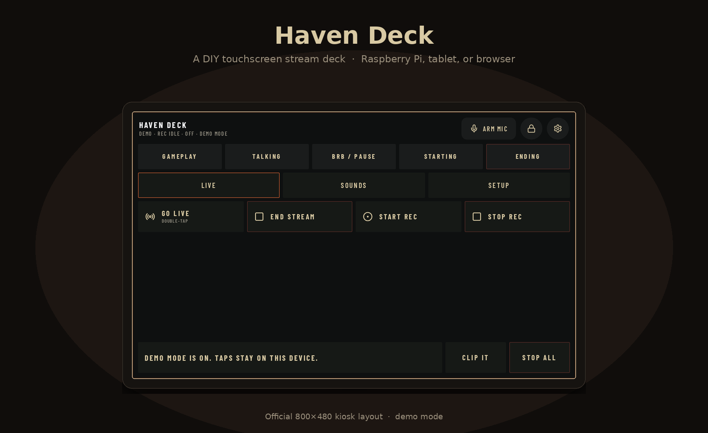
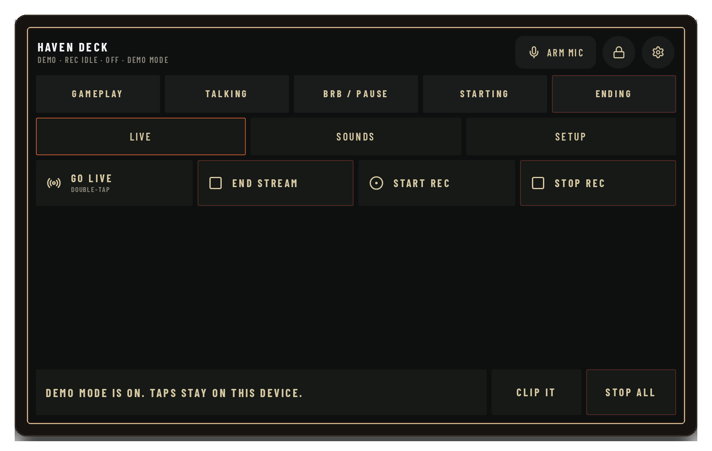
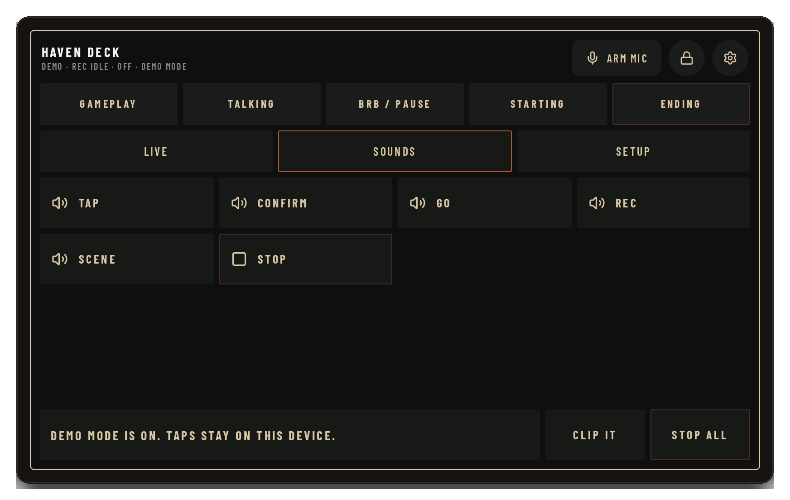
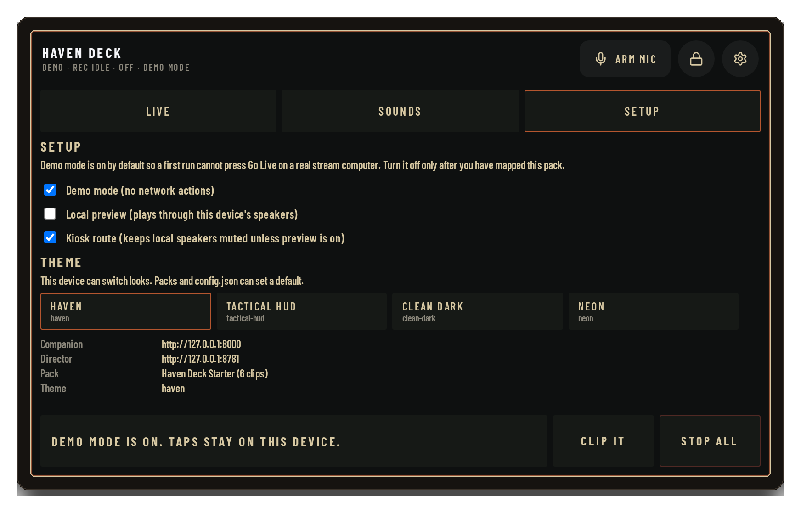
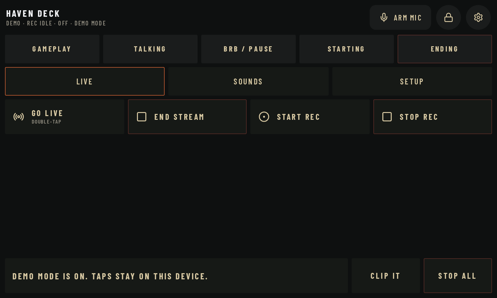
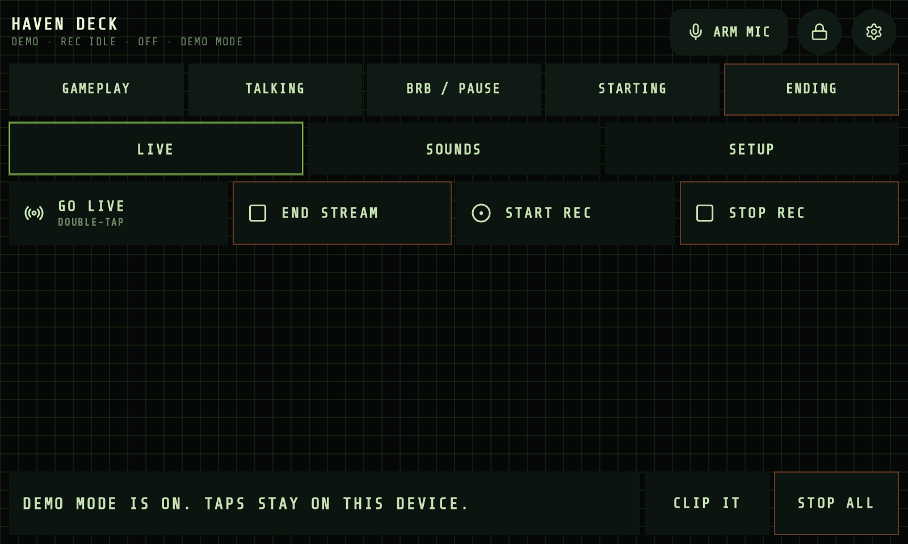
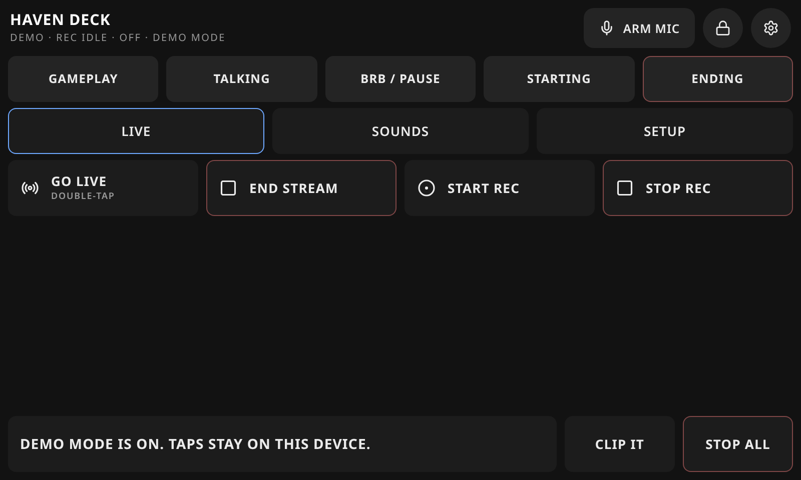
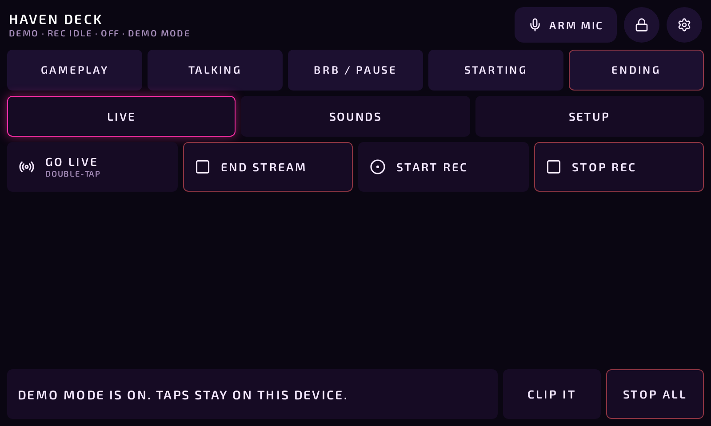

# Haven Deck

A DIY touchscreen stream deck for a Raspberry Pi, a tablet, or a browser. Load your own sounds, scenes, and buttons. An alternative to a Stream Deck or Elgato console, not a replacement for one if you already like yours.

[](https://github.com/RFingAdam/haven-deck/actions/workflows/ci.yml)
[](LICENSE)
[](assets/LICENSE)

**This is not the paid "HAVEN Deck" Streamlabs overlay pack**, and it does not include that pack or the paid "Protocol HUD" overlay. Those are third-party products and are not redistributed here. The [Tactical Deck](https://github.com/RFingAdam/tactical-deck) repo has a separate, original OCR overlay also called Protocol HUD. That overlay is Adam's own code. This repo is only the open-source kiosk.

Watch it in use on [Twitch](https://www.twitch.tv/swampbewdy) or [YouTube](https://www.youtube.com/@SwampBewdy).

<p align="center">
  
</p>

### The 800×480 layout

These captures were taken from a headless browser at the official Raspberry Pi touchscreen size, in demo mode.

<p align="center">
  
</p>
<p align="center"><sub>Live — scenes stay on a rail at the top; Go Live needs a second tap.</sub></p>

<p align="center">
  
</p>
<p align="center"><sub>Sounds — drop in your own pack to fill this grid. The scene rail stays put.</sub></p>

<p align="center">
  
</p>
<p align="center"><sub>Setup — demo mode stays on until you map buttons to your own Companion or Director. Switch looks here too.</sub></p>

### Themes

`haven` is the default. It is the tight Field Kit grid: cream type, rust highlights, short scene bars. Switch looks in Setup, pass `?theme=` in the URL, or set `theme` in `config.json` or a pack's `layout.json`. A choice saved in Setup on this device wins; a `?theme=` URL wins for that visit; otherwise a pack theme is used when config is still the default.

<p align="center">
  
  
</p>
<p align="center"><sub>Haven (default) · Tactical HUD</sub></p>

<p align="center">
  
  
</p>
<p align="center"><sub>Clean Dark · Neon</sub></p>

Tactical HUD is original styling meant to sit beside a stream overlay. It does not copy any paid pack's assets or design.

#### Add your own theme

1. Copy `themes/haven/theme.json` to `themes/my-look/theme.json`.
2. Set `id` to `my-look` (lowercase letters, numbers, and hyphens only) and change the variables you want: colors (`--bg`, `--surface`, `--surface-idle`, `--surface-active`, `--text`, `--text-title`, `--text-muted`, `--accent`, `--danger`), shape (`--radius`, `--gap`, `--key-height`, `--rail-height`), type (`--font`, `--font-ui`, `--letter-spacing`), and optional `--glow` or `--grid-line`.
3. Add `{ "id": "my-look", "label": "My Look" }` to `themes/index.json`.
4. Restart `npm run dev` or rebuild. The new look shows up in Setup.

To regenerate the images: `npm run docs:shots`.

## Quick start

You need Node.js 20 or later.

```bash
git clone https://github.com/RFingAdam/haven-deck
cd haven-deck
npm install
npm run dev
```

Open the URL Vite prints (usually `http://127.0.0.1:5173`). Demo mode is on: taps update the deck and can preview sounds, but they do not contact Companion, OBS, or Streamlabs. On the Setup tab you can enable **Local preview** to hear the starter tones through this device.

To serve the production build on this machine:

```bash
npm run build
cp config.example.json config.json
npm start
```

The kiosk server binds to `http://127.0.0.1:4173` and proxies Companion and Director on the same origin so the browser does not have to deal with CORS. Edit `config.json` to point `companionBase` and `directorBase` at your stream computer, then turn Demo mode off.

## Put it on a Raspberry Pi

The official 800×480 Raspberry Pi touchscreen is the layout this kiosk is sized for. Tablets and desktop browsers work too; a wider window gets larger keys.

1. Build the app, or clone this repo on the Pi and run `npm install && npm run build`.
2. Copy `config.example.json` to `config.json`. Leave Demo mode on until your buttons are mapped.
3. Run `npm start`, then `bash pi-setup/kiosk.sh`.
4. On Raspberry Pi OS you can install the systemd units with `sudo bash pi-setup/setup-kiosk.sh`.

The kiosk route does not play sound through the Pi's speakers unless you turn on local preview. That keeps a stream computer's audio path as the one viewers hear.

## Hook it up to a stream

Haven Deck talks HTTP. You can use any combination of these:

| You want | What to run | What the deck does |
|---|---|---|
| Try the UI | Demo mode (default) | Logs the tap. Optional local preview. |
| Scene and stream buttons | [Bitfocus Companion](https://bitfocus.io/companion) on the stream computer | Presses the page, row, and column in `layout.json`. |
| Sound playback on stream | [Tactical Deck](https://github.com/RFingAdam/tactical-deck) Director (`local` engine, often through a virtual cable into OBS or Streamlabs) | `POST /director/play/<clip>` and `POST /director/stop`. |

The starter Live page maps Go Live, End Stream, Start/Stop Rec, and five example scenes to Companion page 1 as a starting point. **Change those coordinates to match your own Companion pages before you turn Demo mode off.** Go Live always requires a second tap.

A later release will add an optional engine that plays clips into the microphone bus. This first release does not include that engine.

## Add your own sounds

A pack is a folder with a manifest, a layout, and WAV files:

```
my-pack/
  pack.json       # name, license, credit, clip list
  layout.json     # pages and keys
  sounds/         # 48 kHz WAV clips listed in pack.json
  faces/          # optional key art
```

Copy the folder to `packs/my-pack/`, point `packUrl` at `/packs/my-pack`, and rebuild (or place it under `public/packs/` during `npm run dev`).

`pack.json` follows the same clip shape as Tactical Deck, so a pack can be reused:

- `id`, `label`, `category`, `file`, `seconds`, `usage`, `license`, `credit`
- Clip ids are lowercase (`tap`, `scene_chime`) and files must sit under `sounds/` as `.wav`

`layout.json` describes the touch surface:

- `theme`: optional look id (`haven`, `tactical-hud`, `clean-dark`, `neon`, or one you add)
- `sceneRail`: key ids that stay visible on every tab
- Each key has `label`, `icon`, `tone`, and an `action`:
  - `companion`: `{ "type": "companion", "page": 1, "row": 0, "column": 1 }` (pages are 1-based; rows and columns are 0-based)
  - `play`: `{ "type": "play", "clipId": "tap" }` (Director)
  - `http`: `{ "type": "http", "method": "POST", "url": "/director/stop" }`
  - `scene`, `page`, `toggle`, or `none`
- Set `confirmMs` on any key that must not fire on a single tap (Go Live uses `2500`)
- `previewSrc` is a pack-relative WAV used only when local preview is on

If you publish a pack, keep a `license` and `credit` on the pack and on each clip. Community packs can use any license you choose. CC BY 4.0 is a good default if you want credit back.

The six starter tones in `packs/starter/` are original synthesized cues, licensed CC BY 4.0. Credit:

```
Haven Deck starter pack by SwampBewdy (twitch.tv/swampbewdy), CC BY 4.0
```

For cinematic stream stingers, install the [Tactical Pack](https://github.com/RFingAdam/tactical-deck) (also CC BY 4.0) and point sound keys at its clip ids through Director.

## Licenses

- **Code** is [MIT](LICENSE), copyright Adam Engelbrecht.
- **Starter sounds and sample assets** are [CC BY 4.0](assets/LICENSE). MIT does not require a credit line on a stream or video. CC BY does.

## Roadmap

- Tighter Tactical Deck Director and Companion install docs, including a ready-made Tactical Pack layout.
- A sanitized, optional sound engine that can play clips into a microphone bus (voice effects, headphone ducking). Not in this repository yet.
- An optional future paid song pack. It would be a separate product. This repository will not include those songs, and there is no song catalog in the app today.

## Contributing

Open an issue or a pull request. Do not add third-party meme samples, paid overlay assets, or audio you do not have the right to redistribute. Keep configuration examples on `127.0.0.1` or a placeholder host name, never a real machine address.
